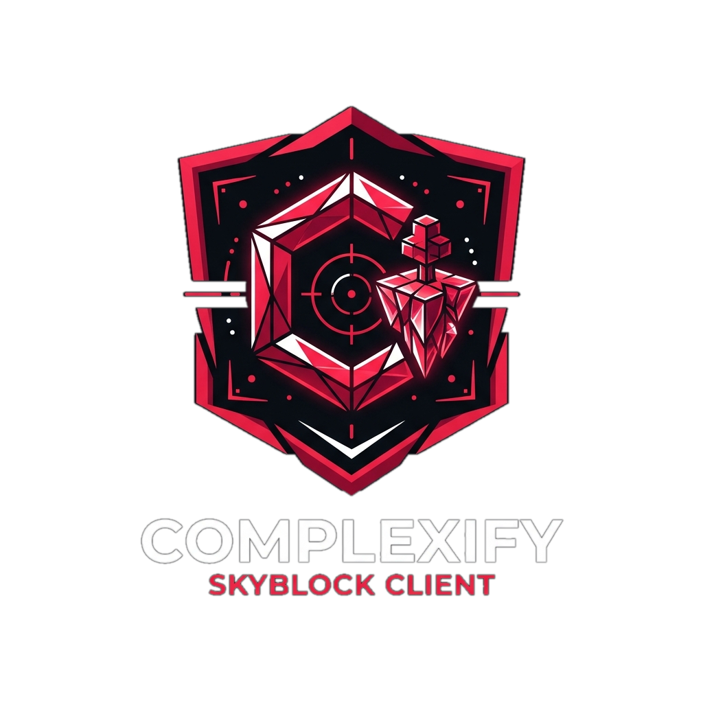
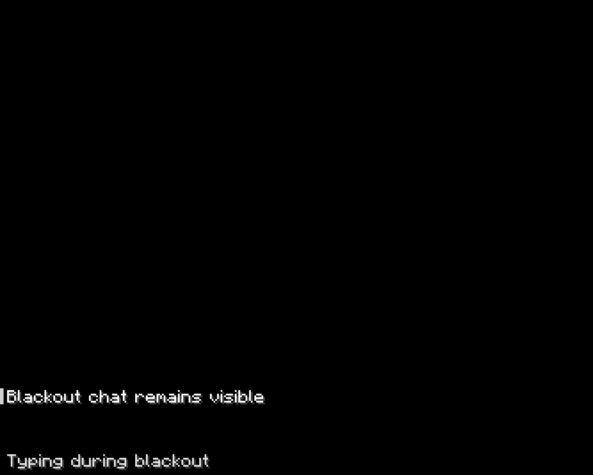

<div align="center">




# Complexify

**The Precision Quality-of-Life HUD & Telemetry Suite for Complex Gaming Skyblock**

[](#)
[](#)
[](#)
[](#)
[](#)

</div>

---

## Installation

### Option 1: 1-Click Modpack (Recommended)
> Pre-configured bundle with **Complexify**, **Simple Voice Chat**, **Litematica**, and Sodium performance optimizations.

1. **Download your launcher bundle** from the [Latest Release](https://github.com/Jlorenzoo/complex-skyblock-tools/releases/latest):
   - **Prism Launcher**: `Full-Pack-Prism-1.21.11.zip`
   - **Modrinth App**: `Full-Pack-Modrinth-1.21.11.mrpack`
2. **Import into your launcher**:
   - In **Prism Launcher**: Click **Add Instance** → **Import from zip** → Select file → **OK**.
   - In **Modrinth App**: Click **Create Instance** → **Import** → Select file.
3. Click **Launch**.

---

### Option 2: Standalone Mod JAR
> For existing Minecraft Fabric profiles.

1. Download **`skyblock-toolkit-1.1.0+mc1.21.11.jar`** from [Releases](https://github.com/Jlorenzoo/complex-skyblock-tools/releases/latest).
2. Place the file into your `.minecraft/mods` directory.
3. Launch Minecraft with **Fabric Loader 0.18.4+** on **Java 21**.

---

### In-Game 1-Click Updates
Complexify checks for updates on startup. Click the chat alert or type **`/complexify update`** to automatically download and install new updates with one click.

---

## Controls & Shortcuts

| Action | Shortcut / Command | Description |
| :--- | :--- | :--- |
| **Open Main Hub** | **`Right Shift`** *(or `Esc` → Complexify)* | Settings dashboard, search, and module configuration |
| **HUD Layout Canvas** | **`/complexify hud`** | In-game visual editor to reposition and toggle widgets |
| **Toggle Blackout** | **`F6`** | Screen dimming for long AFK, farming, or fishing sessions |
| **Check & Install Updates** | **`/complexify update`** | One-click in-game updater |
| **Module Shortcuts** | `/complexify farming`<br>`/complexify boosters`<br>`/complexify fishing`<br>`/complexify chat`<br>`/complexify auction` | Quick jump to specific configuration modules |

---

## In-Game Feature Showcase

All HUD overlays, alerts, and telemetry widgets run natively in **Dark Mode** with clean contrast and zero background clutter.

---

### Group 1: On-Screen HUD & Audio Telemetry

#### 1. Booster Countdown Timers & Toast Alerts
Real-time tracking for active server multipliers and consumable buffs without opening menus.

<div align="center">
  
</div>

- **Dual Countdown Bars**: Green **Money (+20%)** and purple **XP (+150%)** countdown bars display exact remaining time and progress.
- **5-Second Reminder**: Visual cue flashes before a booster expires so you can renew in time.
- **Slide-In Toast Banners**: Floating notifications alert you when boosters trigger, coconuts activate, or timers enter their final countdown.

---

#### 2. Fishing Signals & Audio Cues
High-precision auditory signals and real-time revenue projection for Skyblock fishing.

<div align="center">
  
</div>

- **30-Block Optimal Depth Chime**: Plays a crisp **Note Block Harp (1.6x)** chime the instant your bobber reaches max depth.
- **Custom Bite Splash Tone**: Distinct audible pebble/water-drop sound on hook.
- **Depleted Area Warning**: Descending **Note Block Bass** sequence warns when a fishing spot is exhausted.
- **Line Snap Alert**: Immediate item-break warning sound when a line snaps.
- **Catch Rate Valuation**: Rolling 60s / 5m catch rate calculated against live Complex fish market prices (**`$/hr`**).

---

#### 3. Crop Harvest & Gold Shard Telemetry
Live financial telemetry overlay calculated continuously as you farm.

<div align="center">
  
</div>

- **Rolling Hourly Revenue**: Evaluates your live 10-second and hourly crop farming revenue (**`$/hr`**).
- **Gold Shard Tracking**: Live session counter and value estimates for rare Gold Shard drops.
- **Wand Compatibility**: Fully tracks sales from Auto-Sell and Sell-All wands.

---

#### 4. Treasure Chest Event Countdown & Tracker
Synchronized on-screen timer for server treasure events.

<div align="center">
  
</div>

- **Synchronized Server Countdown**: Displays the exact remaining time until the chest despawns.
- **Final 30-Second Warning**: Flashes alert prompts during the closing window before despawn.
- **Legitimate Event Tracking**: Purely reads official server broadcasts and scoreboard events — not an ESP, hack, or x-ray.

---

#### 5. Seasonal Gear: Bone Leggings (Item & Badge Variant)
Dedicated status HUD for custom server equipment and seasonal armor.

<div align="center">
  
</div>

- **Item & Mode Badge Variant**: Displays the Bone Leggings icon overlaid with an active ability badge.
- **Speed vs. Regen Status**: Flame badge for Speed ignition mode; heart badge for non-combat Regen mode.
- **Cooldown Readiness Glint**: Dynamic glint effect indicates when abilities are ready to trigger.

---

### Group 2: Visual & Gameplay Quality of Life

#### 6. HUD Layout Editor (`/complexify hud`)
Visually rearrange and toggle every on-screen widget directly in the live game environment.

<div align="center">
  
</div>

- **Drag & Drop Positioning**: Move any timer, rate tracker, or status widget anywhere on your screen.
- **1-Click Visibility Toggles**: Click the eye icons directly on the canvas to show or hide individual displays.
- **Edge Snapping**: Elements automatically snap along screen borders and stacked timer rows.

---

#### 7. Clear Harvest Crop Visibility
Built-in dynamic resource pack that makes fully grown crops pop out immediately.

<div align="center">
  
</div>

- **No More Accidental Harvesting**: Immature wheat, carrots, potatoes, nether wart, and beetroots are **90% desaturated & 25% darkened**.
- **Golden Harvest Pop**: Mature, harvest-ready crops retain full vibrant color so you never waste clicks on immature crops.
- **1-Click In-Game Toggle**: Switch between Clear Harvest and vanilla textures in **Right Shift → Farming**.

---

#### 8. Native Chat Text Selection & Clipboard Copy
Interact with Minecraft chat like a modern desktop application.

<div align="center">
  
</div>

- **Drag-to-Select**: Click and drag your mouse cursor across chat lines to highlight text smoothly.
- **Word & Line Selection**: Double-click to highlight a word; triple-click to select an entire line.
- **Clipboard Copy (Ctrl+C / Cmd+C)**: Copy clean text directly to your system clipboard while preserving clickable server links and `/commands`.

---

#### 9. Blackout Focus Mode (AFK Screen Preservation)
Designed for long farming, fishing, and AFK sessions.

<div align="center">
  
</div>

- **One-Touch Dimming (`F6`)**: Dims screen opacity from 0% to 100% to eliminate OLED burn-in and night-time glare during long AFK sessions, while alert audio chimes and chat overlay remain fully active with zero loss of player control.

---

### Group 3: Benchmarks & Telemetry

#### 10. Mining & XP Rate Benchmark Telemetry
Live telemetry benchmarks and interactive graph analysis in dark mode.

<div align="center">
  
</div>

- **Live Performance Curves**: Track XP gain in real-time across 1-minute, 5-minute, or continuous free-run tests.
- **Booster Isolation**: Compares raw base XP against active booster multipliers to measure true farm efficiency.
- **Session History**: Detailed ledgers track past earnings, boosts, and rate test logs.

---

## Proximity Voice Chat on Complex

Complex Gaming uses **[Simple Voice Chat](https://modrinth.com/plugin/simple-voice-chat)** by Max Henkel (Lunar Client is not required).
- Included in the **Full Modpack** out of the box.
- Press **V** to configure your microphone and speakers.
- Default keybinds:
  - Hold **Caps Lock** to talk
  - Hold **Right Alt** to whisper
  - **F8** to mute microphone
  - **N** to toggle voice chat on/off
- Type **`/voice`** in-game on Complex for server voice settings and permissions.

---

## Building from Source

Requirements: **Python 3** and **Java 21** (or Java 25 for 26.2 legacy profile).

```bash
# Clone the repository
git clone https://github.com/Jlorenzoo/complex-skyblock-tools.git
cd complex-skyblock-tools

# Build the mod JAR and run regression tests
python3 build.py

# Run test suites
python3 tests/test_updater.py
python3 tests/test_installer.py
```

For advanced launcher configurations and development documentation, see [DEVELOPMENT.md](DEVELOPMENT.md).

---

## License & Community

- Distributed under the [GNU General Public License v3.0](LICENSE).
- Built with ❤️ for the **Complex Gaming** community.
