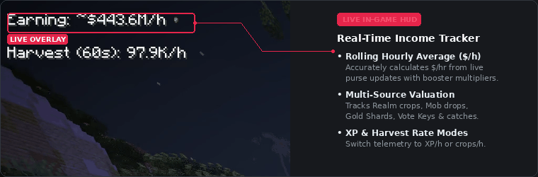
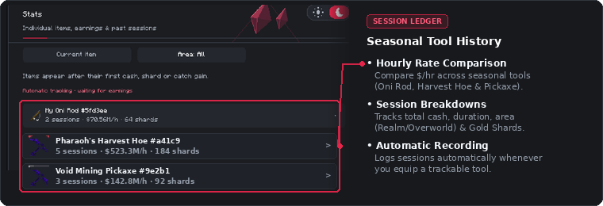
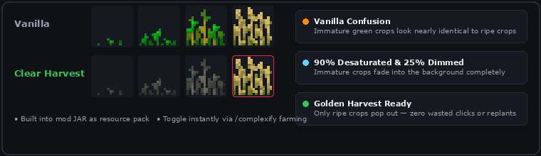
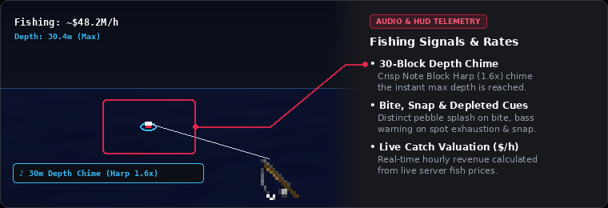
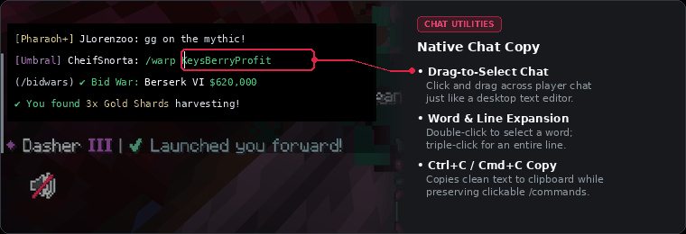

<div align="center">


# Complexify

**The Precision Quality-of-Life HUD & Telemetry Suite for Complex Gaming Skyblock**

[](#)
[](#)
[](#)
[](#)
[](#)

</div>

---

## Installation

- **Modpack (Recommended):**
  - **1.21.11:** Prism Launcher ([`.zip`](https://github.com/Jlorenzoo/complex-skyblock-tools/releases/download/v1.1.137/Full-Pack-Prism-1.21.11.zip)) &nbsp;-&nbsp; Modrinth App ([`.mrpack`](https://github.com/Jlorenzoo/complex-skyblock-tools/releases/download/v1.1.137/Full-Pack-Modrinth-1.21.11.mrpack))
  - **26.2:** Prism Launcher ([`.zip`](https://github.com/Jlorenzoo/complex-skyblock-tools/releases/download/v1.1.137/Full-Pack-Prism-26.2.zip)) &nbsp;-&nbsp; Modrinth App ([`.mrpack`](https://github.com/Jlorenzoo/complex-skyblock-tools/releases/download/v1.1.137/Full-Pack-Modrinth-26.2.mrpack))
- **Standalone JAR** *(drop into `.minecraft/mods`, requires Fabric Loader 0.18.4+ & Java 21)*:
  - Minecraft 1.21.11 ([`.jar`](https://github.com/Jlorenzoo/complex-skyblock-tools/releases?q=mc1.21.11)) &nbsp;-&nbsp; Minecraft 26.2 ([`.jar`](https://github.com/Jlorenzoo/complex-skyblock-tools/releases?q=mc26.2))

---

## Controls

Press **`Right Shift`** *(or `Esc` → Complexify)* in-game to open the settings hub.

---

## Features

All overlays and telemetry widgets run natively in **Dark Mode** with crisp contrast and Lunar Client–inspired aesthetics. Every HUD element can be moved or hidden at any time via **`/complexify hud`**.

---

### Real-Time Income Tracker ($/hr)
The flagship telemetry engine of Complexify. Continuously evaluates your earnings and displays your live revenue per hour directly on your HUD as you play.

<div align="center">
  
</div>

- **Live Rolling Income**: Calculates instant 10-second bursts and hourly averages (**`$/hr`**) in real time from server balance updates.
- **Wand & Auto-Sell Integration**: Accurately accounts for sales from Sell-All wands, chest sells, and passive income.
- **Multi-Resource Tracking**: Also tracks **Minecraft XP per hour** and **Crop harvest rates** (crops/hr and rare Gold Shards) with their own dedicated on-screen HUD counters.

---

### Seasonal Tool History & $/hr Comparison
Automatic session ledgers that track and compare earnings per hour across your tools and seasonal gear.

<div align="center">
  
</div>

- **Hourly Rate Comparison**: Easily compare how much money each seasonal tool or setup makes per hour (e.g. Oni Rod vs. Harvest Hoe & Pickaxe).
- **Session Breakdowns**: Tracks total cash earned, duration, area (Realm vs. Overworld), and Gold Shards collected.
- **Automatic Recording**: Automatically logs sessions when holding trackable tools with no manual start/stop required.

---

### Clear Harvest Crop Visibility
Built-in resource pack that makes fully grown crops immediately distinguishable from immature ones.

<div align="center">
  
</div>

- **Zero Wasted Clicks**: Immature wheat, carrots, potatoes, nether wart, and beetroots are **90% desaturated & 25% darkened**.
- **Harvest-Ready Pop**: Fully grown crops retain full golden color, letting you spot ripe crops instantly from a distance.
- **1-Click In-Game Toggle**: Switch between Clear Harvest and vanilla textures in **Right Shift → Farming**.

---

### Fishing Signals & Audio Telemetry
Auditory depth cues, bite alerts, and live market catch valuation for Skyblock fishing.

<div align="center">
  
</div>

- **30-Block Optimal Depth Chime**: Plays a crisp **Note Block Harp (1.6x)** chime the moment your bobber reaches max depth.
- **Custom Bite Splash Tone**: Distinct audible pebble/water-drop sound on hook.
- **Depleted Area Warning**: Descending **Note Block Bass** sequence warns when a fishing spot is exhausted.
- **Line Snap Alert**: Immediate item-break warning sound when a line snaps.
- **Catch Rate Valuation**: Real-time rolling catch revenue calculated from live server fish market prices (**`$/hr`**).

---

### Native Chat Selection & Clipboard Copy
Highlight and copy text directly from in-game chat like a desktop text editor.

<div align="center">
  
</div>

- **Drag-to-Select**: Click and drag your mouse cursor across chat lines to highlight text smoothly.
- **Word & Line Expansion**: Double-click to select a word; triple-click to select an entire line.
- **Clipboard Copy (Ctrl+C / Cmd+C)**: Copies clean text directly to your system clipboard while preserving clickable server links and `/commands`.

---

### Mining & XP Rate HUD
Live Minecraft XP per hour and rate test progress rendered directly on your in-game HUD.

<div align="center">
  
</div>

- **Live XP/hr Overlay**: Tracks rolling 60-second Minecraft XP gain directly on your HUD as you mine or farm.
- **Booster Isolation**: Toggle whether active XP boosters are included to measure raw base efficiency.
- **1m, 5m & Free-Run Tests**: Displays active timed benchmark progress and results on your screen.

---

### Booster Countdown Timers & Toast Alerts
Independent countdown clocks for server multipliers and consumable buffs.

<div align="center">
  
</div>

- **Dual Countdown Bars**: Green **Money (+39%)** and purple **XP (+150%)** bars display exact remaining time and active multipliers.
- **5-Second Reminder**: Subtle visual flash warns you before a booster expires so you can re-activate without losing your boost.
- **Slide-In Alerts**: Floating toast banners slide in when boosters activate or coconuts trigger.

---

### Seasonal Gear: Bone Leggings
Dedicated HUD indicator tracking status and ability cooldowns for custom server equipment.

<div align="center">
  
</div>

- **Item & Mode Badge Variant**: Displays the leggings icon overlaid with an active status badge.
- **Speed vs. Regen Modes**: Speed boot badge for Speed ignition mode; heart badge for non-combat health recovery.
- **Cooldown Readiness Glint**: Dynamic glint effect shows when abilities are off cooldown and ready to trigger.

---

### Treasure Chest Event Countdown & Tracker
Synchronized on-screen countdown timer for server treasure chest events.

<div align="center">
  
</div>

- **Synchronized Server Countdown**: Displays the exact remaining time until the chest despawns.
- **Final 30-Second Warning**: Flashes alert prompts during the closing window before despawn.
- **Legitimate Event Tracking**: Purely reads official server broadcasts and scoreboard events (not an ESP, radar hack, or memory reader).

---

### Blackout Focus Mode (AFK Screen Preservation)
Screen dimming designed for long farming, fishing, and AFK sessions without display wear.

<div align="center">
  
</div>

- **One-Touch Dimming (`F6`)**: Dims screen opacity from 0% to 100% to eliminate OLED burn-in and night-time glare during long AFK sessions, while alert audio chimes and chat overlay remain fully active with zero loss of player control.

---

## Building from Source

Requirements: **Python 3** and **Java 21** (or Java 25 for 26.2 legacy profile).

```bash
# Clone the repository
git clone https://github.com/Jlorenzoo/complex-skyblock-tools.git
cd complex-skyblock-tools

# Build the mod JAR and run regression tests
python3 build.py

# Run test suites
python3 tests/test_updater.py
python3 tests/test_installer.py
```

For advanced launcher configurations and development documentation, see [DEVELOPMENT.md](DEVELOPMENT.md).

---

## License & Community

- Distributed under the [GNU General Public License v3.0](LICENSE).
- Built with ❤️ for the **Complex Gaming** community.
