<div align="center">


# Complexify

**The Precision Quality-of-Life HUD & Telemetry Suite for Complex Gaming Skyblock**

[](#)
[](#)
[](#)
[](#)
[](#)

</div>

---

## 📥 Quick & Easy Installation

Choose the option that fits your setup:

### Option 1: 1-Click Modpack *(Recommended)*
> **Best for teammates & new players!** Includes everything pre-configured: **Complexify**, **Proximity Voice Chat**, **Litematica**, and top performance optimizations. Zero manual configuration required.

1. **Download your launcher bundle** from the [Latest Release](https://github.com/Jlorenzoo/complex-skyblock-tools/releases/latest):
   - **Prism Launcher**: Download `Full-Pack-Prism-1.21.11.zip`
   - **Modrinth App**: Download `Full-Pack-Modrinth-1.21.11.mrpack`
2. **Import into your launcher**:
   - In **Prism Launcher**: Click **Add Instance** → **Import from zip** → Choose the file → Click **OK**.
   - In **Modrinth App**: Click **Create Instance** → **Import** → Choose the file.
3. Click **Launch** and enjoy!

---

### Option 2: Standalone Mod JAR *(Existing Fabric Profile)*
> Add Complexify to your existing Minecraft Fabric setup.

1. Download **`skyblock-toolkit-1.1.0+mc1.21.11.jar`** from the [Latest Release](https://github.com/Jlorenzoo/complex-skyblock-tools/releases/latest).
2. Place the `.jar` file directly into your `.minecraft/mods` directory.
3. Launch Minecraft using **Fabric Loader 0.18.4+** on **Java 21**.

---

### ⚡ Automatic 1-Click Updates
Never browse GitHub or drag files again:
- Complexify automatically checks for updates in the background on startup.
- When an update is released, click the notification in chat or run **`/complexify update`** to automatically download and install it in one click.

---

## 🎮 Controls & Shortcuts

| Action | Shortcut / Command | Description |
| :--- | :--- | :--- |
| **Open Complexify Hub** | **`Right Shift`** *(or `Esc` → Complexify)* | Main navigation dashboard and settings hub |
| **Interactive HUD Canvas** | **`/complexify hud`** | Visual drag-and-drop HUD repositioning & visibility toggles |
| **Toggle Blackout (AFK)** | **`F6`** | Screen dimming for long farming/fishing sessions |
| **Check & Install Updates** | **`/complexify update`** | One-click in-game updater |
| **Direct Module Shortcuts** | `/complexify farming`<br>`/complexify boosters`<br>`/complexify fishing`<br>`/complexify chat`<br>`/complexify auction` | Jump straight to any specific configuration module |

---

## ✨ Features Showcase

### 🎯 1. Modern Configuration Hub & Themes
A clean, responsive Lunar Client–inspired hub styled in Crimson Red (`#E5254A`) and dark graphite panels. Features instant search across all settings, structured categories, and seamless switching between **Dark Mode** and **Light Mode**.

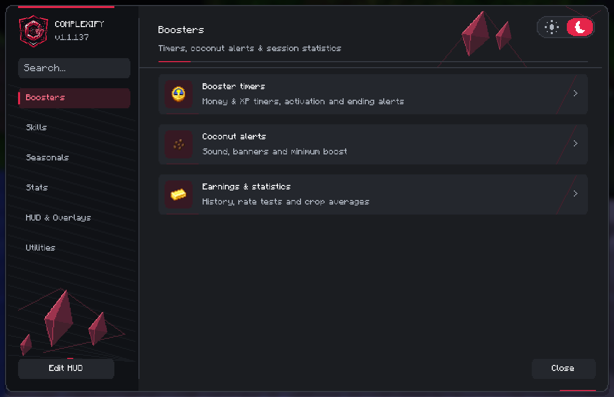

<div align="center">
<sub>Seamless one-click switch between Dark Mode and Light Mode across all menus and inputs:</sub>
</div>

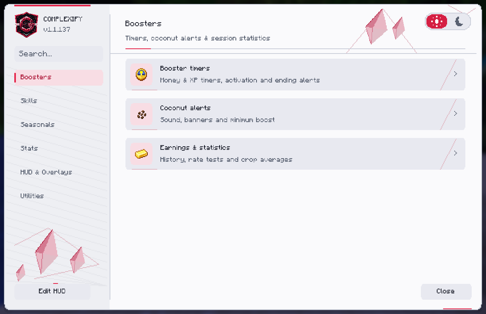

---

### 📐 2. Interactive Drag & Drop HUD Canvas
Take full control of your on-screen HUD with the visual layout editor (`/complexify hud`).
- **Drag & Drop Placement**: Move your Money Timer, XP Timer, Crop Earnings, and Fishing stats anywhere on screen.
- **Toggle Visibility**: Click the inline eye icons to show or hide individual displays on the fly.
- **Snapping Guides**: Clean grid snapping keeps elements aligned with screen edges.

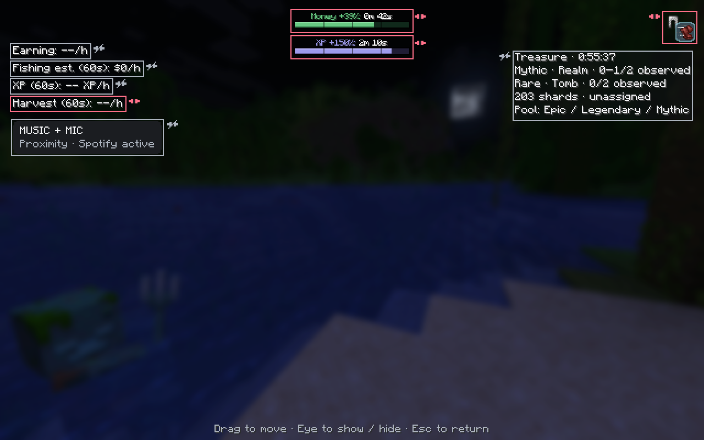

---

### ⏱️ 3. Booster Timers & Activation Alerts
Keep precise track of your active boosters and consumables without opening menus.
- **Independent Money & XP Timers**: Green money (+20%) and purple XP (+150%) countdown bars display exact remaining time.
- **5-Second Expiry Reminder**: Subtle audio-visual cues notify you before a booster expires so you never lose your multiplier.
- **Consumable Tracker**: Accurately tracks active coconut and booster item durations.

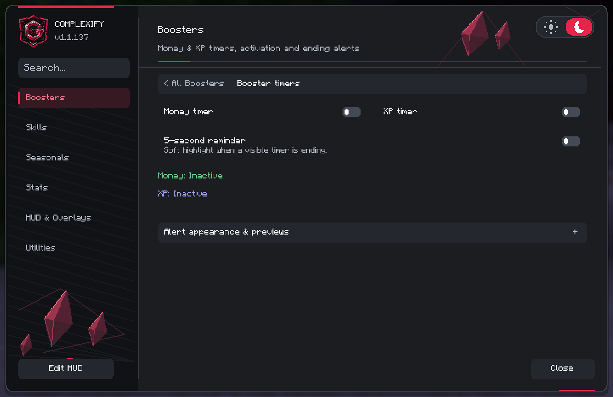

---

### 🌾 4. Farming Hub & Clear Harvest Textures
Maximize crop revenue with integrated telemetry and texture enhancements.
- **Built-in Clear Harvest Textures**: Immature wheat, carrots, potatoes, nether wart, and beetroots are 90% desaturated and 25% darkened, making fully grown crops instantly stand out.
- **One-Click In-Game Toggle**: Switch between Clear Harvest and vanilla textures instantly under the Farming tab.
- **Crop Earnings & Gold Shards**: Live rolling harvest rate (`$/hr`), session tallies, and Gold Shard accounting.

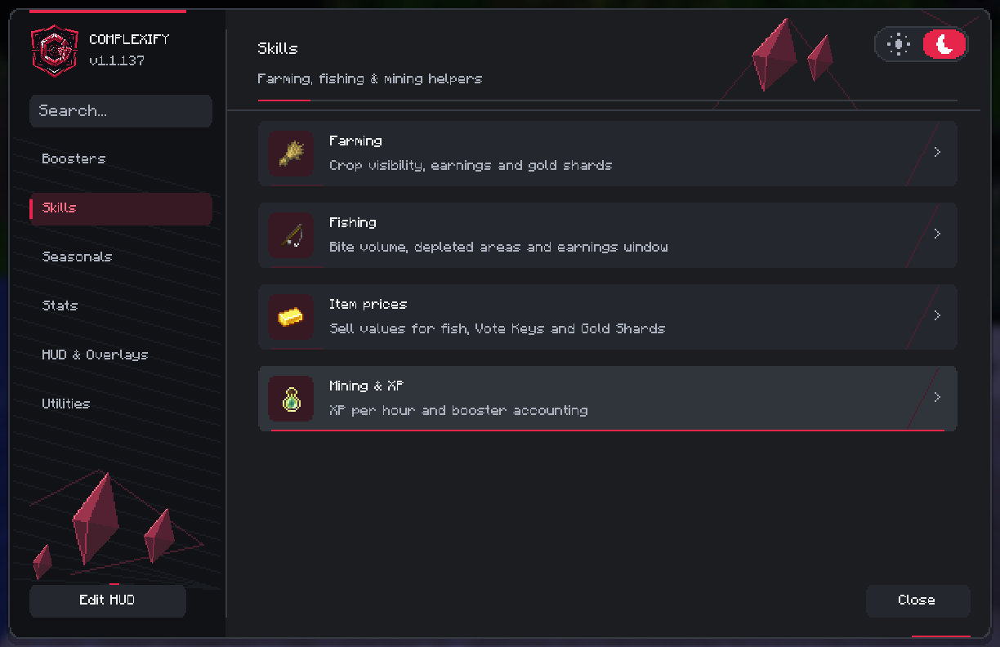

---

### 🎣 5. Fishing Signals & Live Catch Valuation
Turn fishing into an automated, high-precision workflow.
- **Optimal Depth Audio Chime**: Plays a distinct audio signal the instant your bobber reaches optimal depth (30 blocks).
- **Bite & Snap Alerts**: Custom audio warnings for bite detections, depleted fishing spots, and snapped lines.
- **Projected Hourly Value**: Real-time rolling catch rates and projected `$/hr` earnings based on live server market prices.

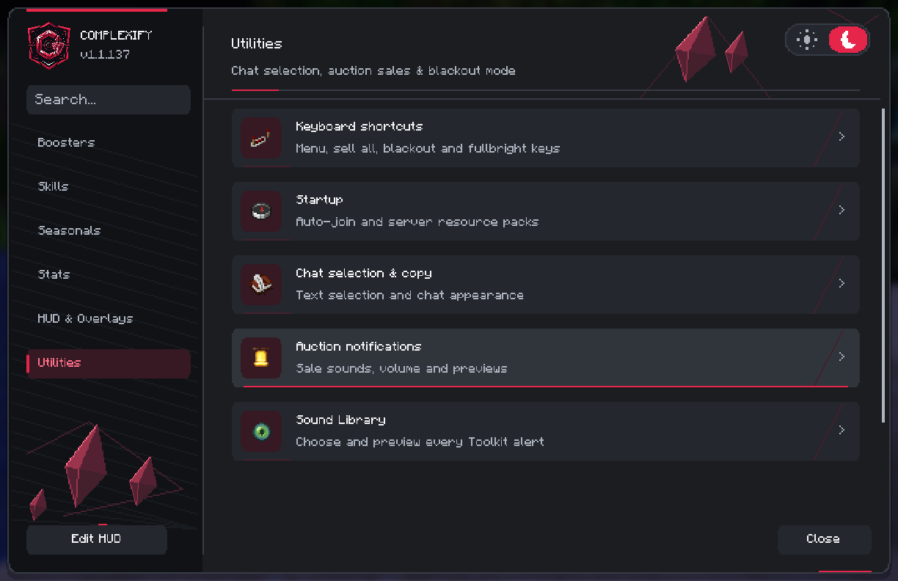

---

### 📈 6. Mining & XP / Rate Tests
Benchmark your efficiency with built-in telemetry and graphing.
- **Live XP per Hour Telemetry**: Run 1-minute, 5-minute, or continuous free-run benchmark tests with real-time visual performance curves.
- **Booster Accounting**: Isolate raw base XP from booster multipliers to measure true farm efficiency.
- **Session History Ledger**: Review past boosts, revenue averages, and rate test logs.

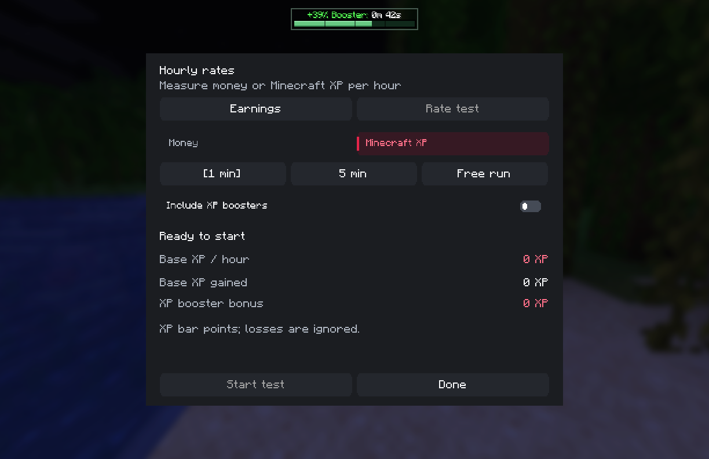

---

### 💬 7. Native Chat Selection & Clipboard Copy
Interact with Minecraft chat like a modern desktop application.
- **Drag-to-Select**: Click and drag your mouse across chat lines to highlight text smoothly.
- **Multi-Click Expansion**: Double-click to select a word; triple-click to select the entire line.
- **Instant Copy**: Press **Ctrl + C** (or **Cmd + C** on macOS) to copy directly to your clipboard. Clickable links and commands remain fully functional.

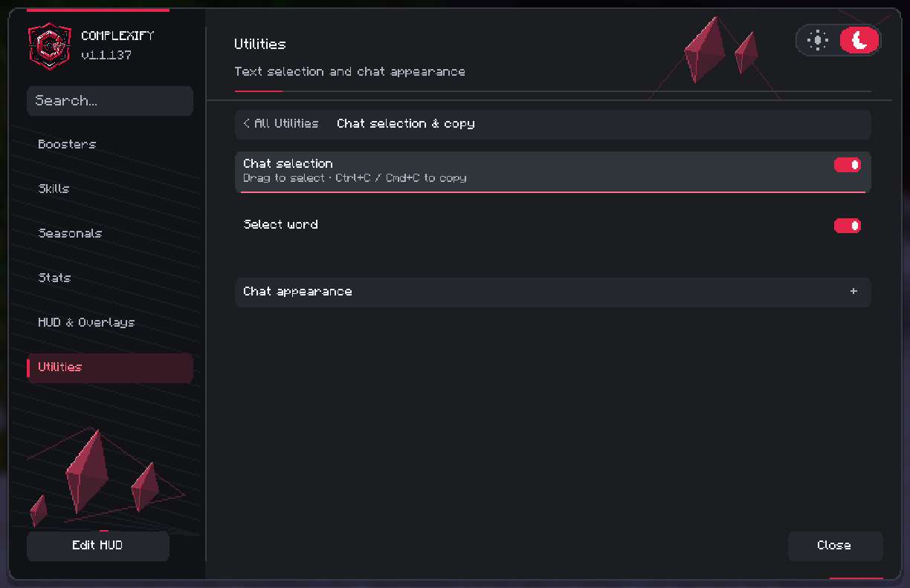

---

### 🌑 8. Blackout Mode (AFK & Screen Preservation)
Designed for long farming, fishing, and AFK sessions.
- **Instant Toggle (`F6`)**: Dim the screen opacity anywhere from 0% to 100% to protect OLED displays and eliminate night-time glare.
- **Stay Informed**: Game audio, alert chimes, full player controls, and optional chat overlay remain fully active while dimmed.

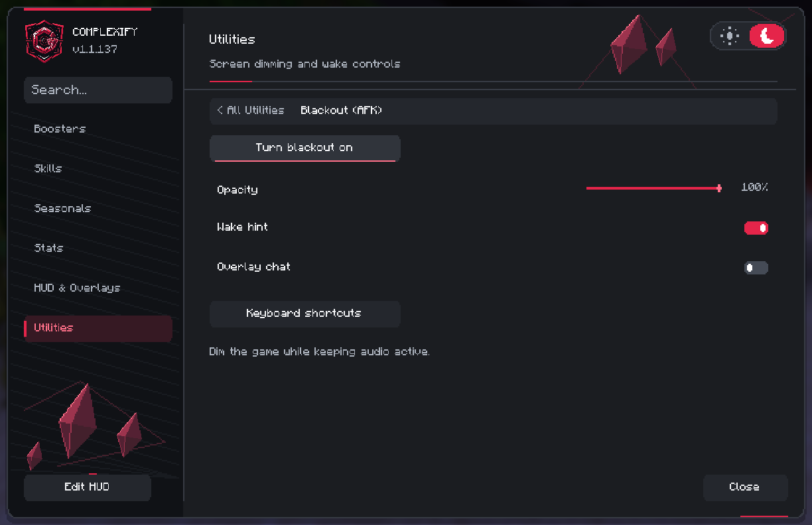

---

### ⚔️ 9. Seasonal Gear & Unique Item Trackers
Specialized tracking for server-specific items and unique gear.
- **Gear Telemetry**: Monitor active cooldowns, special stats, and abilities for gear like the **Oni Mask** and **Bone Leggings**.
- **On-Screen Effect Icons**: Clean HUD indicators show when seasonal abilities are active or ready to trigger.

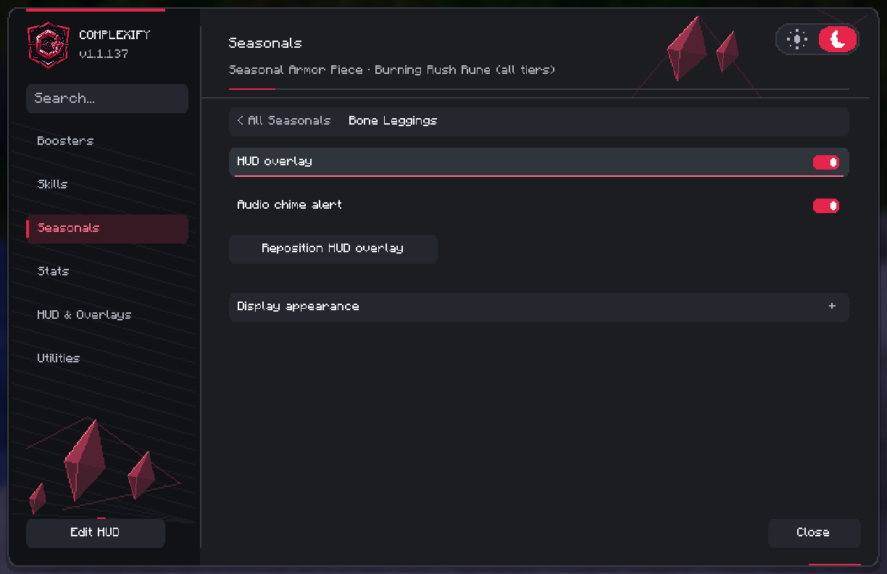

---

### 🚀 10. Startup Auto-Join, Auction Alerts & Utilities
Everyday quality-of-life utilities that streamline your Skyblock experience.
- **Skyblock Auto-Join**: Automatically connect straight to Complex Skyblock (`skyblock.mc-complex.com`) on startup, complete with automatic server resource pack approval and timeout retry.
- **Auction House Sale Chime**: Instant audio notification whenever an item sells on the Auction House.
- **Sound Library**: Audition and configure all mod audio chimes and cues directly in-game.

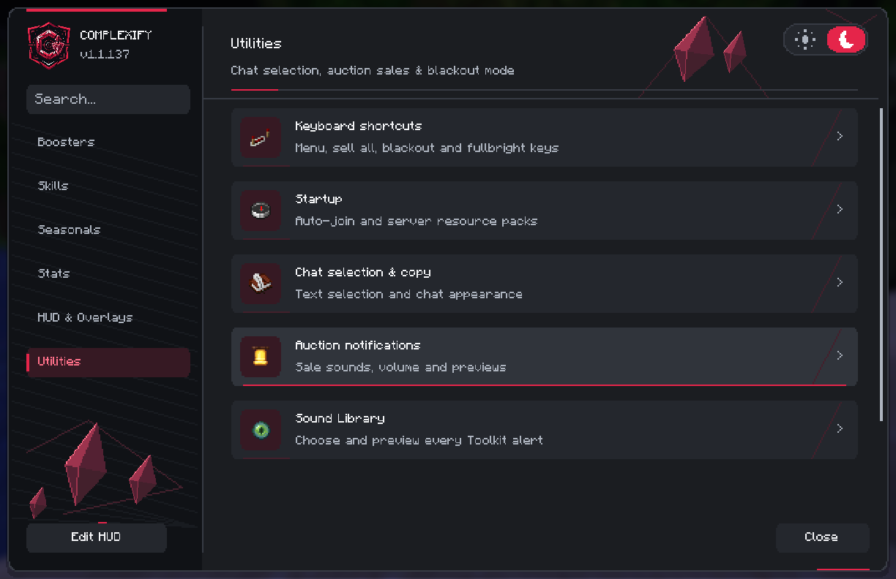

---

## 🎙️ Proximity Voice Chat on Complex

Complex Gaming uses **[Simple Voice Chat](https://modrinth.com/plugin/simple-voice-chat)** by Max Henkel (Lunar Client is not required).
- The **Full Modpack** includes voice chat out of the box.
- Press **V** to configure your microphone and speakers.
- Default keybinds:
  - Hold **Caps Lock** to talk
  - Hold **Right Alt** to whisper
  - **F8** to mute microphone
  - **N** to toggle voice chat on/off
- Type **`/voice`** in-game on Complex for server voice settings and permissions.

---

## 🛠️ Building from Source

Requirements: **Python 3** and **Java 21** (or Java 25 for 26.2 legacy profile).

```bash
# Clone the repository
git clone https://github.com/Jlorenzoo/complex-skyblock-tools.git
cd complex-skyblock-tools

# Build the mod JAR and run regression tests
python3 build.py

# Run test suites
python3 tests/test_updater.py
python3 tests/test_installer.py
```

For advanced launcher configurations and development documentation, see [DEVELOPMENT.md](DEVELOPMENT.md).

---

## 📄 License & Community

- Distributed under the [GNU General Public License v3.0](LICENSE).
- Built with ❤️ for the **Complex Gaming** community.
