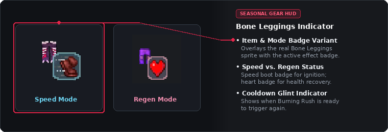

<div align="center">


# Complexify

**The Precision Quality-of-Life HUD & Telemetry Suite for Complex Gaming Skyblock**

[](#)
[](#)
[](#)
[](#)
[](#)

</div>

---

## 📥 Quick & Easy Installation

Choose the option that fits your setup:

### Option 1: 1-Click Modpack *(Recommended)*
> **Best for teammates & new players!** Includes everything pre-configured: **Complexify**, **Proximity Voice Chat**, **Litematica**, and top performance optimizations. Zero manual configuration required.

1. **Download your launcher bundle** from the [Latest Release](https://github.com/Jlorenzoo/complex-skyblock-tools/releases/latest):
   - **Prism Launcher**: Download `Full-Pack-Prism-1.21.11.zip`
   - **Modrinth App**: Download `Full-Pack-Modrinth-1.21.11.mrpack`
2. **Import into your launcher**:
   - In **Prism Launcher**: Click **Add Instance** → **Import from zip** → Choose the file → Click **OK**.
   - In **Modrinth App**: Click **Create Instance** → **Import** → Choose the file.
3. Click **Launch** and enjoy!

---

### Option 2: Standalone Mod JAR *(Existing Fabric Profile)*
> Add Complexify to your existing Minecraft Fabric setup.

1. Download **`skyblock-toolkit-1.1.0+mc1.21.11.jar`** from the [Latest Release](https://github.com/Jlorenzoo/complex-skyblock-tools/releases/latest).
2. Place the `.jar` file directly into your `.minecraft/mods` directory.
3. Launch Minecraft using **Fabric Loader 0.18.4+** on **Java 21**.

---

### ⚡ Automatic 1-Click Updates
Never browse GitHub or drag files again:
- Complexify automatically checks for updates in the background on startup.
- When an update is released, click the notification in chat or run **`/complexify update`** to automatically download and install it in one click.

---

## 🎮 Controls & Shortcuts

| Action | Shortcut / Command | Description |
| :--- | :--- | :--- |
| **Open Complexify Hub** | **`Right Shift`** *(or `Esc` → Complexify)* | Main navigation dashboard and settings hub |
| **Interactive HUD Canvas** | **`/complexify hud`** | Visual drag-and-drop HUD repositioning & visibility toggles |
| **Toggle Blackout (AFK)** | **`F6`** | Screen dimming for long farming/fishing sessions |
| **Check & Install Updates** | **`/complexify update`** | One-click in-game updater |
| **Direct Module Shortcuts** | `/complexify farming`<br>`/complexify boosters`<br>`/complexify fishing`<br>`/complexify chat`<br>`/complexify auction` | Jump straight to any specific configuration module |

---

## 🕹️ In-Game Functionality Showcase

All HUD overlays, alerts, and telemetry are rendered natively in **Dark Mode** with crisp contrast and Lunar Client–inspired aesthetics.

### 📐 1. Live Drag & Drop HUD Layout Editor (`/complexify hud`)
Reposition and configure every on-screen HUD widget directly inside the live game environment.
- **Interactive Dragging**: Move Money Timers, XP Timers, Crop Earnings, and Fishing stats with pixel precision.
- **Inline Visibility Toggles**: Click the eye icons directly on the canvas to hide or show any element.
- **Smart Alignment**: Screen-edge snapping keeps your HUD clean and balanced.


---

### ⏱️ 2. Booster Countdown Timers & Notification Banners
Track your active server multipliers and consumable buffs without opening menus.
- **Dual HUD Countdown Bars**: Independent emerald green Money (`+20%`) and amethyst purple XP (`+150%`) countdown bars display exact remaining time and progress.
- **5-Second Reminder**: Subtle on-screen flash before a booster expires so you can renew without losing your streak.
- **Floating Toast Alerts**: Slide-in banner notifications when boosters trigger, coconuts activate, or timers enter their final countdown.


---

### 🌾 3. Clear Harvest Crop Visibility (Built-In Resource Pack)
Eliminate accidental harvesting and wasted clicks during farming runs.
- **Instant Visual Distinction**: Immature wheat, carrots, potatoes, nether wart, and beetroots are 90% desaturated and 25% darkened.
- **Harvest-Ready Pop**: Fully grown crops retain their vibrant golden colors, making them immediately identifiable from a distance.
- **One-Click In-Game Toggle**: Switch between Clear Harvest and vanilla textures in-game (`Right Shift → Farming`).


---

### 💰 4. Live Crop Harvest & Gold Shard HUD Overlay
Real-time financial telemetry calculated as you harvest.
- **Rolling Revenue Telemetry**: Calculates instant 10-second and hourly crop revenue (`$/hr`) in real time.
- **Gold Shard Tracking**: Live session counter and value estimates for rare Gold Shards.
- **Full Wand Support**: Fully compatible with Auto-Sell and Sell-All wands.


---

### 🎣 5. Fishing Signals & Real-Time Catch Valuation
Turn fishing into an automated, high-precision workflow.
- **30-Block Optimal Depth Chime**: Plays a crisp audio chime the instant your bobber reaches optimal 30-block depth.
- **Bite & Line Snap Audio Cues**: Distinct auditory alerts for fish bites, line snaps, and depleted fishing spots.
- **Hourly Catch Rate Estimation**: Real-time rolling catch values evaluated against live Complex Skyblock fish market prices.


---

### 📈 6. Mining & XP Rate Benchmark Telemetry
Live telemetry benchmarks and interactive graph analysis in dark mode.
- **Real-Time Performance Graphs**: Run 1-minute, 5-minute, or free-run benchmark tests with real-time curve plots.
- **Booster Isolation**: Compare raw base XP against active booster multipliers to measure true farm efficiency.
- **Historical Session Ledger**: Review past session stats, average rates, and historical logs.


---

### 💬 7. Native Chat Selection & Clipboard Copy
Interact with Minecraft chat like a modern desktop application.
- **Drag-to-Select**: Click and drag your mouse across chat messages to highlight text seamlessly.
- **Smart Gestures**: Double-click to select a word; triple-click to select an entire line.
- **Instant Copy**: Press **Ctrl + C** (or **Cmd + C** on macOS) to copy directly to your clipboard while preserving clickable server commands and links.


---

### 🌑 8. Blackout Focus Mode (AFK & Screen Preservation)
Built for long farming, fishing, and AFK grinding sessions.
- **One-Key Dimming (`F6`)**: Dim screen opacity from 0% to 100% to protect OLED displays and eliminate glare at night.
- **Zero Loss of Control**: Full character controls, audio alert chimes, and optional chat overlay remain completely active while dimmed.


---

### ⚔️ 9. Seasonal Item Abilities & Cooldown HUD
Specialized on-screen status tracking for custom server equipment.
- **Active Ability Indicators**: Live HUD effect icons for gear like **Bone Leggings** (Speed / Regen modes) and **Oni Mask**.
- **Cooldown & State Glint**: Visual indicators display when special abilities are active, cooling down, or ready to fire.



---

### 🧭 10. Treasure Chest Discovery Radar HUD
Never miss a server treasure chest event.
- **Live Event Countdown**: Displays the exact synchronized server countdown timer on your HUD.
- **Final 30-Second Warning**: Flashing alert prompts in the closing window before chest expiration.
- **Distance & Value Telemetry**: Real-time distance and discovery estimates.


---

## 🎙️ Proximity Voice Chat on Complex

Complex Gaming uses **[Simple Voice Chat](https://modrinth.com/plugin/simple-voice-chat)** by Max Henkel (Lunar Client is not required).
- The **Full Modpack** includes voice chat out of the box.
- Press **V** to configure your microphone and speakers.
- Default keybinds:
  - Hold **Caps Lock** to talk
  - Hold **Right Alt** to whisper
  - **F8** to mute microphone
  - **N** to toggle voice chat on/off
- Type **`/voice`** in-game on Complex for server voice settings and permissions.

---

## 🛠️ Building from Source

Requirements: **Python 3** and **Java 21** (or Java 25 for 26.2 legacy profile).

```bash
# Clone the repository
git clone https://github.com/Jlorenzoo/complex-skyblock-tools.git
cd complex-skyblock-tools

# Build the mod JAR and run regression tests
python3 build.py

# Run test suites
python3 tests/test_updater.py
python3 tests/test_installer.py
```

For advanced launcher configurations and development documentation, see [DEVELOPMENT.md](DEVELOPMENT.md).

---

## 📄 License & Community

- Distributed under the [GNU General Public License v3.0](LICENSE).
- Built with ❤️ for the **Complex Gaming** community.
