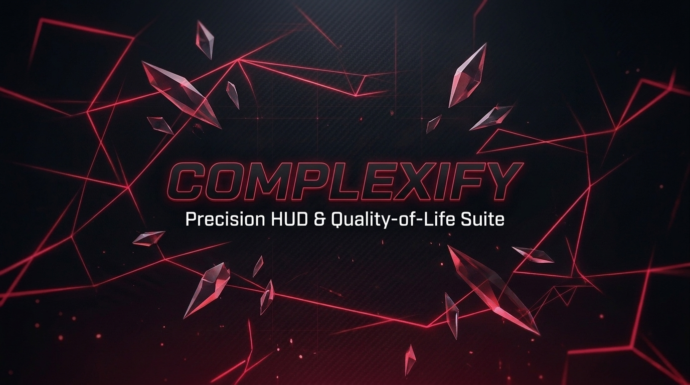
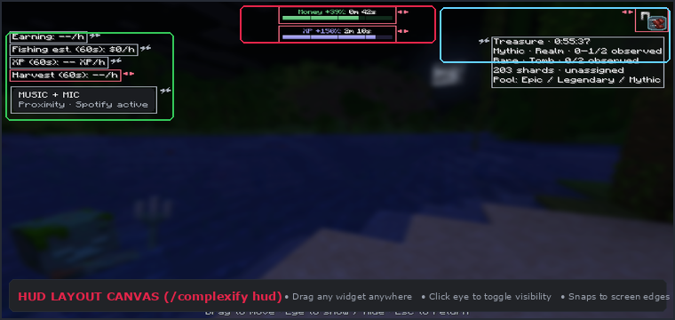
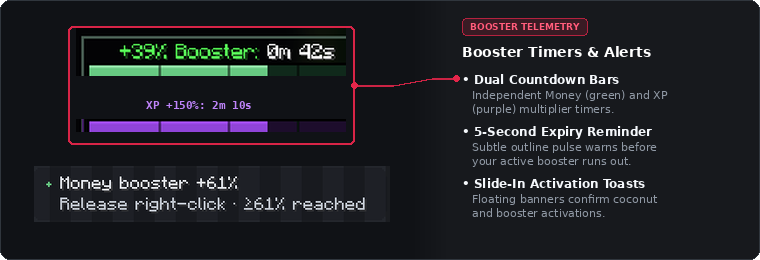
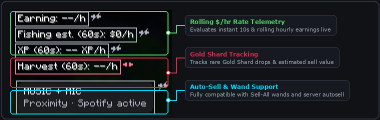
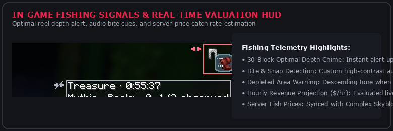
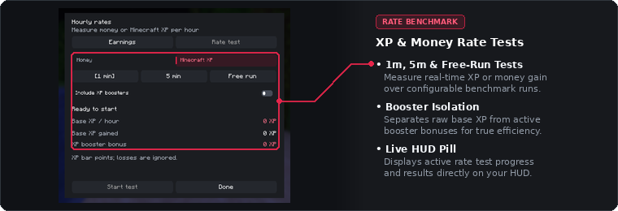
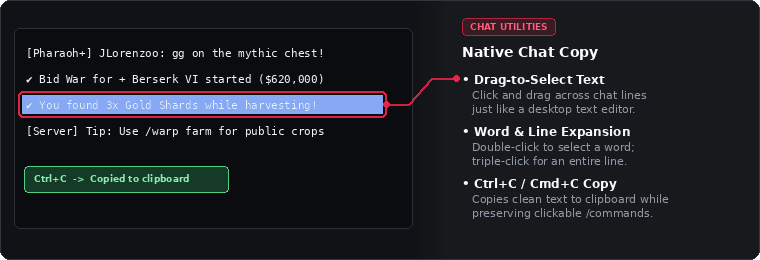
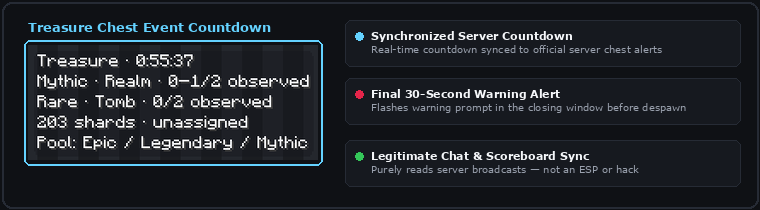

<div align="center">




# Complexify

**The Precision Quality-of-Life HUD & Telemetry Suite for Complex Gaming Skyblock**

[](#)
[](#)
[](#)
[](#)
[](#)

</div>

---

## 📥 Quick & Easy Installation

### Option 1: 1-Click Modpack *(Recommended)*
> **Best for teammates & new players.** Pre-configured with **Complexify**, **Proximity Voice Chat**, **Litematica**, and top performance optimizations.

1. **Download your launcher bundle** from the [Latest Release](https://github.com/Jlorenzoo/complex-skyblock-tools/releases/latest):
   - **Prism Launcher**: `Full-Pack-Prism-1.21.11.zip`
   - **Modrinth App**: `Full-Pack-Modrinth-1.21.11.mrpack`
2. **Import into your launcher**:
   - In **Prism Launcher**: Click **Add Instance** → **Import from zip** → Select file → Click **OK**.
   - In **Modrinth App**: Click **Create Instance** → **Import** → Select file.
3. Click **Launch** to play!

---

### Option 2: Standalone Mod JAR *(Existing Fabric Setup)*
1. Download **`skyblock-toolkit-1.1.0+mc1.21.11.jar`** from [Releases](https://github.com/Jlorenzoo/complex-skyblock-tools/releases/latest).
2. Drop the `.jar` into your `.minecraft/mods` folder.
3. Launch Minecraft with **Fabric Loader 0.18.4+** on **Java 21**.

---

### ⚡ 1-Click Automatic Updates
- Complexify checks for updates in the background on startup.
- Click the alert in chat or run **`/complexify update`** to automatically download and install updates in 1 click.

---

## 🎮 Controls & Shortcuts

| Action | Shortcut / Command | What It Does |
| :--- | :--- | :--- |
| **Open Main Hub** | **`Right Shift`** *(or `Esc` → Complexify)* | Settings dashboard, search & configuration |
| **HUD Layout Canvas** | **`/complexify hud`** | Drag & drop on-screen HUD elements & toggle eye icons |
| **Toggle Blackout (AFK)** | **`F6`** | Screen dimming for long farming/fishing sessions |
| **Check & Install Updates** | **`/complexify update`** | One-click mod updater |
| **Module Shortcuts** | `/complexify farming`<br>`/complexify boosters`<br>`/complexify fishing`<br>`/complexify chat`<br>`/complexify auction` | Quick jump to specific settings |

---

## 🕹️ In-Game Functionality Showcase

Every HUD display and telemetry feature is rendered natively in **Dark Mode** with clean contrast and zero background clutter.

---

### 📐 1. Drag & Drop HUD Layout Editor
> Visually rearrange and toggle every on-screen widget directly in-game.

<div align="center">
  
</div>

- **Command**: Run **`/complexify hud`** (or click *Edit HUD* in the hub).
- **Pixel-Accurate Positioning**: Click and drag any timer, rate tracker, or radar widget anywhere on screen.
- **1-Click Visibility Toggles**: Click the eye icons directly on the canvas to show or hide individual displays.
- **Screen Snapping**: Elements snap neatly along screen borders and HUD stacks.

---

### ⏱️ 2. Booster Countdown Timers & Toast Alerts
> Track active multipliers and consumable buffs without opening any menus.

<div align="center">
  
</div>

- **Independent Dual Bars**: Separate emerald green **Money (+20%)** and amethyst purple **XP (+150%)** countdown bars show exact remaining time.
- **5-Second Reminder**: Subtle visual cues flash before a booster expires so you can renew in time.
- **Floating Toast Banners**: Slide-in notification banners trigger on booster activation and coconut consumption.

---

### 🌾 3. Clear Harvest Crop Visibility
> Built-in dynamic resource pack that makes fully grown crops pop out immediately.

<div align="center">
  
</div>

- **Eliminate Wasted Clicks**: Immature wheat, carrots, potatoes, nether wart, and beetroots are **90% desaturated & 25% darkened**.
- **Instant Golden Pop**: Mature, harvest-ready crops retain their full vibrant colors.
- **1-Click In-Game Toggle**: Switch between Clear Harvest and vanilla textures in **Right Shift → Farming**.

---

### 💰 4. Live Crop Harvest & Gold Shard Telemetry
> Real-time earnings overlay calculated continuously as you farm.

<div align="center">
  
</div>

- **Rolling Hourly Rate**: Evaluates your live 10-second and hourly crop farming revenue (**`$/hr`**).
- **Gold Shard Tracking**: Live session counter and value estimates for rare Gold Shard drops.
- **Wand Compatibility**: Seamlessly tracks sales from Auto-Sell and Sell-All wands.

---

### 🎣 5. Fishing Signals & Market Catch Valuation
> High-precision audio cues and projected revenue for Skyblock fishing.

<div align="center">
  
</div>

- **30-Block Optimal Depth Chime**: Plays a crisp audio cue the instant your bobber reaches max depth.
- **Smart Audio Alerts**: Distinct tones for bite detections, snapped lines, and depleted fishing spots.
- **Projected Hourly Catch Value**: Evaluates rolling 60s / 5m catch rates against live server fish prices.

---

### 📈 6. Mining & XP Rate Benchmark Telemetry
> Benchmark your farming efficiency with real-time telemetry graphing.

<div align="center">
  
</div>

- **Live Performance Curves**: Track XP gain in real-time across 1-minute, 5-minute, or continuous free-run tests.
- **Booster Isolation**: Compares raw base XP against active booster multipliers to measure true farm efficiency.
- **Session History**: Detailed ledgers track past earnings, boosts, and rate test logs.

---

### 💬 7. Native Chat Selection & Clipboard Copy
> Select and copy chat messages like a desktop application.

<div align="center">
  
</div>

- **Drag-to-Select**: Click and drag your cursor across chat lines to highlight text smoothly.
- **Multi-Click Selection**: Double-click to select a single word; triple-click to select the entire line.
- **Instant Copy**: Press **Ctrl + C** (or **Cmd + C** on macOS) to copy to clipboard while preserving clickable server links.

---

### 🌑 8. Blackout Focus Mode (AFK & Screen Preservation)
> Designed for long farming, fishing, and AFK sessions without display wear.

<div align="center">
  
</div>

- **Instant Toggle (`F6`)**: Dim screen opacity from 0% to 100% to eliminate OLED burn-in and night-time glare.
- **Live Background Passthrough**: Audio chimes, player controls, and optional chat overlay remain fully functional.

---

### ⚔️ 9. Seasonal Item Abilities & Cooldown HUD
> On-screen status tracking for custom server equipment and seasonal tools.

<div align="center">
  
</div>

- **Mode Indicators**: Live on-screen icons for gear like **Bone Leggings** (Speed / Regen modes) and **Oni Mask**.
- **Dynamic Glint & Cooldown**: Visual cues show when special abilities are active, cooling down, or ready to fire.

---

### 🧭 10. Treasure Chest Discovery Radar HUD
> Synchronized radar tracking for server treasure events.

<div align="center">
  
</div>

- **Synchronized Countdown**: Real-time event countdown synced directly to server chat alerts.
- **Closing Window Warning**: Flashes alert prompts during the final 30 seconds before chest despawn.

---

## 🎙️ Proximity Voice Chat on Complex

Complex Gaming uses **[Simple Voice Chat](https://modrinth.com/plugin/simple-voice-chat)** by Max Henkel (Lunar Client is not required).
- The **Full Modpack** includes voice chat out of the box.
- Press **V** to configure your microphone and speakers.
- Default keybinds:
  - Hold **Caps Lock** to talk
  - Hold **Right Alt** to whisper
  - **F8** to mute microphone
  - **N** to toggle voice chat on/off
- Type **`/voice`** in-game on Complex for server voice settings and permissions.

---

## 🛠️ Building from Source

Requirements: **Python 3** and **Java 21** (or Java 25 for 26.2 legacy profile).

```bash
# Clone the repository
git clone https://github.com/Jlorenzoo/complex-skyblock-tools.git
cd complex-skyblock-tools

# Build the mod JAR and run regression tests
python3 build.py

# Run test suites
python3 tests/test_updater.py
python3 tests/test_installer.py
```

For advanced launcher configurations and development documentation, see [DEVELOPMENT.md](DEVELOPMENT.md).

---

## 📄 License & Community

- Distributed under the [GNU General Public License v3.0](LICENSE).
- Built with ❤️ for the **Complex Gaming** community.
