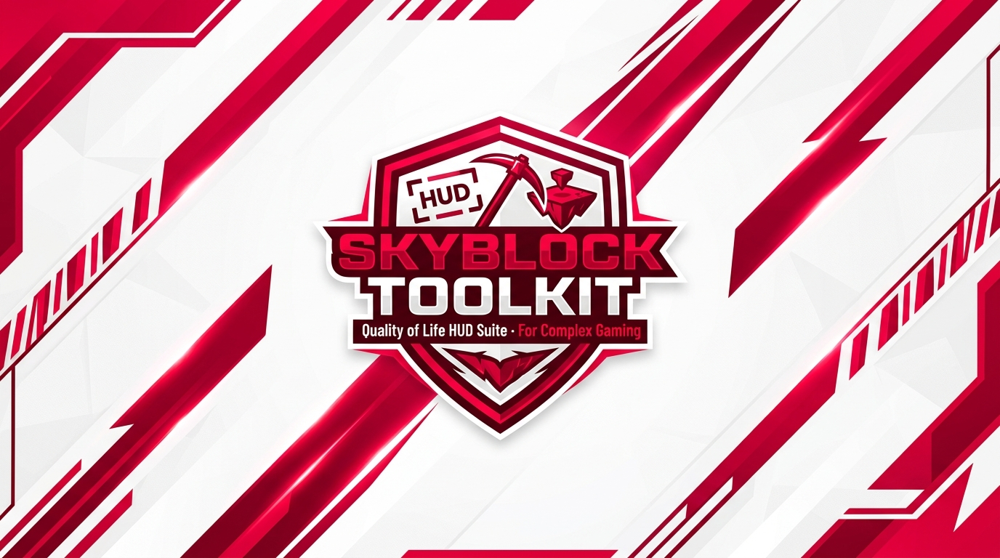

<div align="center">




# Skyblock Toolkit

**The Essential Quality-of-Life HUD & Stats Suite for Complex Gaming Skyblock**

[](#)
[](#)
[](#)
[](#)
[](#)

</div>

---

## Quick Installation

### Minecraft 1.21.11 (maintained pack target)

Use the separate **[Fabric 1.21.11 download](https://github.com/Jlorenzoo/complex-skyblock-tools/releases/tag/v1.1.0-mc1.21.11)**:
`skyblock-toolkit-1.1.0+mc1.21.11.jar`. It requires Java 21, Fabric Loader >=0.18.4
and Fabric API for 1.21.11. Place it in your 1.21.11 profile's `mods` folder and
press **Right Shift**. See [installation and build instructions](versions/1.21.11/README.md).
Future pack updates target 1.21.11. `python build.py` builds the current sources,
runs regressions and produces the matching jar; `python scripts/install.py --wait`
safely installs it into the configured profile. Keep your previous profile as a fallback.

### Method 1: Fabric Mod (Recommended)
Works seamlessly with your existing Fabric profile alongside **Litematica**, **Sodium**, **Iris**, and other client mods.

1. Ensure you have **Fabric Loader (>= 0.18.4)** and **Fabric API** installed for **Minecraft 1.21.11**.
2. Download **[Skyblock Toolkit for Fabric 1.21.11](https://github.com/Jlorenzoo/complex-skyblock-tools/releases/tag/v1.1.0-mc1.21.11)**.
3. Place the `.jar` directly into your `.minecraft/mods/` folder.
4. Launch Minecraft and press **`Right Shift`** (or type `/toolkit`) to open the settings hub!

### Historical 26.2 Prism pack
The existing published Prism ZIP targets Minecraft 26.2 / Java 25. Use the 1.21.11
jar/profile above for the maintained target. To use that historical pack:

1. Download **[Complex-Skyblock-Prism (Latest Release)](https://github.com/Jlorenzoo/complex-skyblock-tools/releases/latest)**.
2. In Prism Launcher: **Add Instance** → **Import** → select the zip file.
3. Click Launch (Prism handles the Fabric Loader and Java setup automatically).

### ⚡ Automatic Updates
Once installed, you never need to visit GitHub or drag files again:
- The mod automatically checks for updates in the background on startup.
- When an update is ready, an alert appears in chat: `[Skyblock Toolkit] A new update is available! [Click to Update]`
- Click the message or type `/toolkit update` to auto-download and install with one click.

---

## Controls & Shortcuts

Use the **Dark mode / Light mode** button in the toolkit menu header to switch between charcoal/red and off-white/red themes. The choice applies immediately, is saved across restarts, and covers module pages, history, rate tests, sliders and price inputs. Gameplay HUD colors remain consistent.

| Action | Shortcut / Command |
| :--- | :--- |
| **Open Toolkit Hub** | **`Right Shift`** (or `Escape` → *Skyblock Toolkit*) |
| **Toggle Blackout** | **`F6`** *(customizable in settings)* |
| **Main Menu** | `/toolkit` |
| **Drag & Drop HUD Canvas** | `/toolkit hud` |
| **Check & Install Updates** | `/toolkit update` |
| **Module Shortcuts** | `/toolkit farming`, `/toolkit boosters`, `/toolkit fishing`, `/toolkit chat`, `/toolkit auction`, `/toolkit blackout` |

### Proximity voice chat on Complex

Complex uses **[Simple Voice Chat](https://modrinth.com/plugin/simple-voice-chat)** by
Max Henkel. Lunar is not required. The maintained pack pins the Fabric version for
Minecraft 1.21.11 as a separate mod; the old Prism ZIP contains the 26.2 build. For an existing configured profile, run
`python scripts/voicechat.py --install --wait`; restart Minecraft after installation.

Press **V** to select your microphone and speakers and choose **push-to-talk**.
Pack defaults: hold **Caps Lock** to talk, hold **Right Alt** to whisper,
**F8** to mute your microphone, and **N** to disable/re-enable voice chat.
These avoid Litematica's **M** menu; existing voice bindings are preserved on install.
Use **`/voice`** on Complex for server settings and accept its consent prompt yourself.
Complex records and moderates voice chat; proximity range is 48 blocks, whisper range
is 24 blocks, and groups are disabled. See
[Complex's official guide](https://www.mc-complex.com/forums/vanilla/wiki-page/3/complex-gaming-proximity-voice-chat-guide/).
The toolkit jar by itself does not include voice chat; the installer adds the separate jar.

---

## Features

### 🌾 Farming Hub & Clear Harvest Textures
- **Built-in Crop Visibility**: Immature wheat, carrots, potatoes, nether wart, and beetroots are desaturated and dimmed so fully grown crops are instantly distinguishable.
- **Zero-Setup & Auto-Updating**: Included directly inside the mod JAR as a built-in Fabric resource pack. Updates automatically whenever the mod updates.
- **Quick In-Game Toggle**: Switch between Clear Harvest and vanilla textures with one click under the **Farming** tab (`Right Shift` or `/toolkit farming`).
- **Live Crop Earnings & HUD**: Monitor live rolling harvest rates (`$/hr`), toggle the Crop Earnings HUD overlay, and access rate tests directly.

### ⏱️ Booster & Crop Earnings HUD
- **Separate Money & XP Timers**: Green money and purple XP countdowns track their own activations. Only active, enabled timers appear at the top; money appears above XP when both are visible, with no empty row when either is hidden or expires.
- **Visibility & Expiry Reminder**: Open **Right Shift → Boosters** to toggle each timer independently. Enable **5-second reminder** for a subtle ending cue and soft outline during the final five seconds. It starts disabled and does not play a sound. The HUD editor has separate eye controls; drag either timer to move the stack together.
- **Consumable Tracker**: Accurately tracks active coconut and booster item durations with countdown bars.
- **Rolling Earnings**: Live rolling window (10-second / hourly) calculation of crop farming revenue (`$/hr`).
- **Minecraft XP per Hour**: Open **Boosters → Rate tests → Minecraft XP** for 1-minute, 5-minute or free-run tests. **Include XP boosters** switches between actual XP and estimated base XP with the detected booster removed. Rates use XP points across level-ups; losses do not count as income. Farming also offers a separate rolling XP/hour HUD, with its own visibility and draggable position in **Edit HUD**.
- **Session History**: Detailed ledger of your past boosts, earnings, and rate tests.

### 🎣 Fishing Signals & Value Estimates
- **Audio Depth Cue**: Plays a distinct audio chime when your bobber reaches optimal depth (30 blocks).
- **Depleted Area & Snap Alerts**: Warns you with descending audio tones when a fishing spot is depleted or your line snaps.
- **Estimated Hourly Catch Value**: Calculates rolling 60s / 5m catch rates and projected `$/hr` based on your server fish prices.

### 💬 Chat Text Selection & Copy
- **Drag-to-Select**: Click and drag your mouse across in-game chat text to highlight text seamlessly.
- **Multi-Click Selection**: Double-click to select a word; triple-click to select an entire message line.
- **Cross-Platform Copy**: Press **Ctrl + C** (or **Cmd + C** on macOS) to copy text directly to your clipboard. Clickable links and commands remain fully functional.

### 🔔 Auction Alerts & Blackout Mode
- **Auction Sale Chime**: Immediate custom audio notification when an item sells on the Auction House.
- **Blackout Focus**: Dim the screen opacity (0–100%) during long farming or fishing sessions while keeping full controls and game audio active.

---

## Building from Source

Requirements: Python 3 and Java 25.

For launcher paths, Windows setup, regression checks and safe installation, see [DEVELOPMENT.md](DEVELOPMENT.md). Machine-specific paths belong in ignored `local-settings.json`.

```bash
# Clone the repository
git clone https://github.com/Jlorenzoo/complex-skyblock-tools.git
cd complex-skyblock-tools

# Build the mod jar
python3 build.py

# Run test suite
python3 tests/test_updater.py
python3 tests/test_installer.py
```

Produces `build/skyblock-toolkit-1.1.0.jar`.

---

## License & Credits

- Distributed under the [MIT License](LICENSE).
- Designed with ❤️ for the **Complex Gaming** community.
